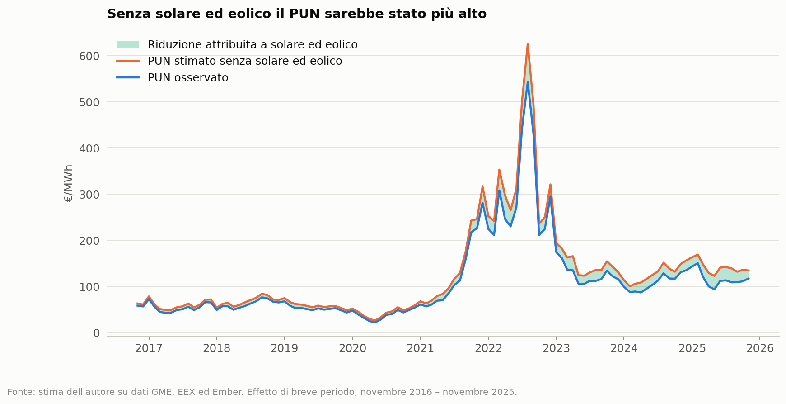
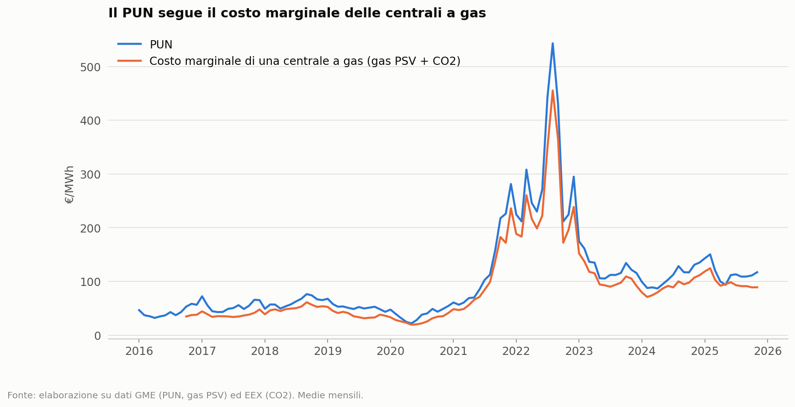
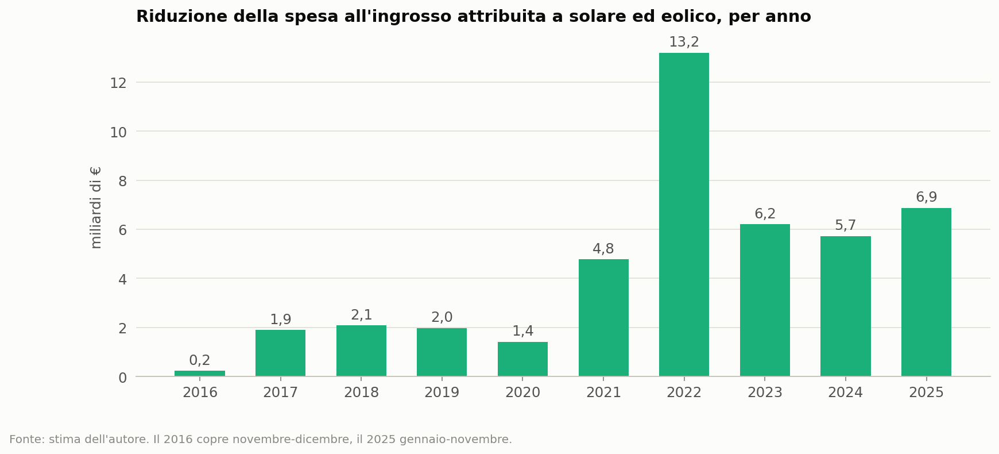
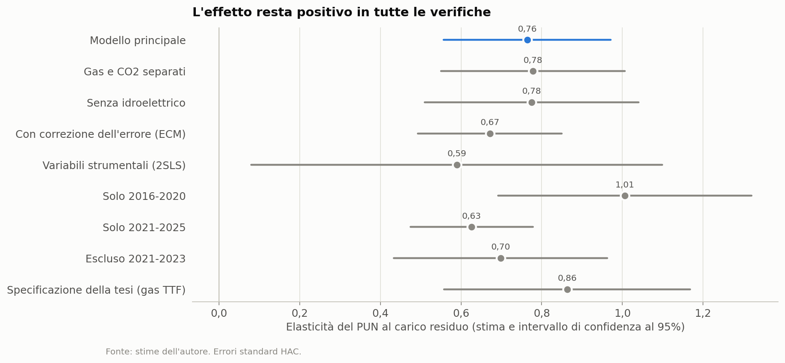
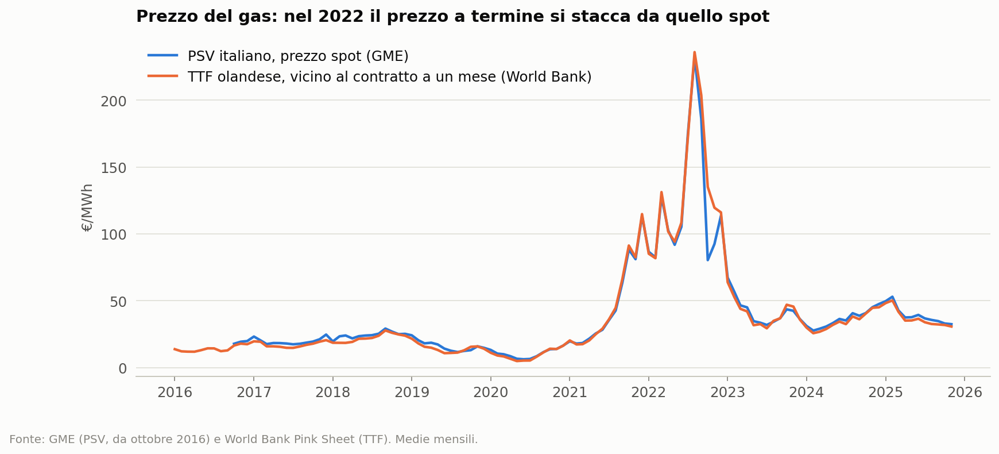

# Quanto abbassano il prezzo dell'elettricità solare ed eolico?

**Determinanti del PUN e *Merit Order Effect* in Italia, 2016-2025**


> **English summary.** An econometric study of the Italian wholesale electricity price (PUN) on monthly data, 2016–2025. An OLS model in log-differences with Newey-West errors estimates how the price responds to the marginal cost of gas-fired plants and to residual load (demand minus solar and wind). A 1% drop in residual load lowers the price by about 0.76%. A counterfactual without solar and wind puts the short-run wholesale saving at roughly €44 billion over nine years (95% CI: 32–58). The result survives instrumental variables, an error-correction model, sub-samples and alternative gas prices. Code, tests and a fully reproducible notebook are included; text and comments are in Italian.

Analisi econometrica del **Prezzo Unico Nazionale (PUN)** dell'energia elettrica su dati mensili. Il lavoro nasce dalla mia tesi di laurea, poi rivista: dati corretti, specificazione migliorata, verifiche di robustezza e test automatici.



## In breve

| | |
|---|---|
| **0,93** | elasticità del PUN al costo marginale delle centrali a gas: il prezzo del gas passa quasi interamente nel prezzo dell'elettricità |
| **0,76** | elasticità del PUN al carico residuo (IC 95%: 0,56 – 0,97): meno domanda da coprire con le centrali termiche, prezzo più basso |
| **16 €/MWh** | riduzione media del PUN attribuita a solare ed eolico (IC: 11,4 – 20,8) |
| **44 mld €** | riduzione cumulata della spesa all'ingrosso, novembre 2016 – novembre 2025 (IC: 31,7 – 57,5) |

Il valore in euro è un effetto **lordo** e **di breve periodo**: vedi [Come leggere i risultati](#come-leggere-i-risultati).

## Domande

1. Quanto dipende il PUN dal costo marginale delle centrali a gas (gas + permessi CO2)?
2. Di quanto solare ed eolico riducono il prezzo (*Merit Order Effect*)?
3. Quanto vale, in euro, questa riduzione?
4. Il risultato regge se si cambiano le ipotesi?

## Metodo

Regressione OLS in log-differenze su 109 mesi (novembre 2016 – novembre 2025), con dummy mensili ed errori standard Newey-West (HAC, 4 ritardi):

$$\Delta \ln PUN_t = \beta_0 + \beta_1 \Delta \ln MC^{CCGT}_t + \beta_2 \Delta \ln RL_t + \beta_3 \Delta \ln Hydro_t + \text{dummy mensili} + \varepsilon_t$$

- **Costo marginale** $MC^{CCGT}$: gas e CO2 di una centrale a ciclo combinato, $P_{gas}/\eta + EF \cdot P_{CO_2}$, con il prezzo spot del gas italiano (PSV).
- **Carico residuo** $RL$: domanda meno solare ed eolico. $\beta_2 > 0$ è il *Merit Order Effect*.
- **Idroelettrico**: variabile di controllo.
- **Controfattuale *add-back***: $PUN^{cf} = PUN \cdot (Demand / RL)^{\hat\beta_2}$, cioè il prezzo osservato riportato a uno scenario senza solare ed eolico. La differenza, moltiplicata per la domanda, dà il valore in euro (Sensfuß et al., 2008).



## Risultati

| | Stima |
|---|---|
| Elasticità al costo marginale | 0,93 (p < 0,001) |
| Elasticità al carico residuo | 0,76 (IC 95%: 0,56 – 0,97) |
| R² | 0,92 |
| Riduzione media del PUN | 16,0 €/MWh (IC: 11,4 – 20,8) |
| Riduzione cumulata della spesa | 44,4 mld € (IC: 31,7 – 57,5) |
| Elasticità a solare + eolico, stima diretta | −0,20 (p < 0,001) |
| Solare / eolico separati | −0,11 (p = 0,002) / −0,07 (p < 0,001) |



La riduzione è più alta negli anni di prezzi elevati. Dipende dalla specificazione: con un'elasticità costante, l'effetto in €/MWh è proporzionale al livello del PUN.

## Robustezza



| Verifica | Risultato |
|---|---|
| Sotto-periodi 2016-2020 / 2021-2025 | elasticità 0,98 / 0,70; differenza significativa (p < 0,001) |
| Controfattuale con elasticità per periodo | 43,3 mld € |
| Solo la **crescita** di solare ed eolico dal 2016 | 10,6 mld € |
| Gas e CO2 stimati separatamente | peso del gas 0,78, contro 0,79 implicito nei parametri (p = 0,91) |
| Senza il controllo per l'idroelettrico | elasticità 0,78; 45,1 mld € |
| Variabili strumentali (2SLS) per la domanda | elasticità 0,59 (IC: 0,08 – 1,10); Hausman non rifiuta l'esogeneità (p = 0,44) |
| Cointegrazione PUN – costo marginale | Engle-Granger −6,06 (p < 0,001); Johansen: una relazione |
| Modello a correzione dell'errore (ECM) | elasticità di breve periodo 0,67 (IC: 0,49 – 0,85); 38,6 mld € |
| Lungo periodo (DOLS) | elasticità al carico residuo 0,18 (IC: −0,12 – 0,48), non significativa |
| Specificazione della tesi (gas TTF, senza idroelettrico) | elasticità 0,86; R² 0,80; 51,8 mld € |

L'effetto di breve periodo resta positivo e significativo in tutte le verifiche.

## Come leggere i risultati

- **Effetto lordo.** Il valore in euro riguarda il prezzo all'ingrosso. Non sottrae gli incentivi alle rinnovabili pagati in bolletta.
- **Breve periodo.** Misura di quanto era più basso il prezzo di ogni mese grazie alla produzione rinnovabile di quel mese, a sistema dato. L'effetto di lungo periodo sul livello dei prezzi non è identificato con questi dati.
- **Ordine di grandezza.** L'elasticità è stimata su variazioni mensili di pochi punti percentuali; lo scenario "zero rinnovabili" è un'estrapolazione. Lo scenario limitato alla crescita dal 2016 è più prudente.
- **Dati mensili.** Il *Merit Order Effect* agisce ora per ora: un modello orario darebbe stime più precise, soprattutto per il solare.

Limiti e verifiche sono discussi per esteso nelle sezioni 7.1, 10 e 12 del notebook.

## Struttura

```
├── analisi_PUN.ipynb       notebook: testo, stime, grafici
├── src/
│   ├── config.py           percorsi e parametri
│   ├── dati.py             costruzione del dataset dalle fonti
│   ├── modelli.py          OLS-HAC, 2SLS, DOLS, test, controfattuale
│   └── grafici.py          stile comune dei grafici
├── tests/                  test automatici (pytest)
├── dati/README.md          come ottenere i dati
├── figure/                 grafici generati dal notebook
└── .github/workflows/      test a ogni modifica
```

## Riprodurre

```bash
python -m venv .venv
.venv\Scripts\activate            # Linux/macOS: source .venv/bin/activate
pip install -r requirements-dev.txt
pytest                            # i test sui modelli usano dati sintetici
```

Il notebook è pubblicato già eseguito, con tutti i risultati. Per rieseguirlo serve il dataset, che **non è incluso** perché alcune fonti non ne consentono la ridistribuzione. Si ricostruisce dalle fonti, tutte gratuite, seguendo [`dati/README.md`](dati/README.md):

```bash
python -m src.dati                # crea dati/elaborati/dataset_mensile.csv
jupyter lab analisi_PUN.ipynb
```

## Differenze rispetto alla tesi

Rivedendo il codice per la pubblicazione sono emersi due errori nei dati, ora corretti, e due punti deboli della specificazione.

1. **Solare ed eolico**: il file Ember riporta ogni variabile in più unità; il codice originale ne faceva la media. Ora si usano solo i TWh.
2. **Gas e CO2**: le serie usate in origine partivano dal 2017 e dal 2021; i mesi precedenti erano riempiti con un valore costante o con zero. Ora le serie sono complete, senza imputazioni.
3. **Prezzo del gas**: il TTF usato nella tesi è un prezzo a termine, mentre il PUN è un prezzo spot. Messo nella stessa regressione, il prezzo spot italiano (PSV) lo sostituisce completamente.
4. **Idroelettrico**: aggiunto come controllo; rende la stima più precisa.



| | Tesi | Dati corretti, stessa specificazione | Questa versione |
|---|---|---|---|
| Elasticità al costo marginale | 0,76 | 0,93 | 0,93 |
| Elasticità al carico residuo | 0,40 | 0,86 | 0,76 |
| R² | 0,67 | 0,80 | 0,92 |
| Riduzione cumulata della spesa | 49,7 mld € | 51,8 mld € | 44,4 mld € |
| Solare / eolico | −0,18 (p = 0,05) / −0,06 (p = 0,08) | −0,12 (p = 0,14) / −0,04 (p = 0,12) | −0,11 (p = 0,002) / −0,07 (p < 0,001) |

La conclusione principale non cambia: un *Merit Order Effect* significativo, del valore di 40-50 miliardi di euro nel periodo.

## Fonti dei dati

GME (PUN, gas PSV) · Ember (domanda e generazione, CC BY 4.0) · World Bank Pink Sheet (gas TTF, CC BY 4.0) · EEX (aste EUA) · Eurostat (gradi-giorno) · FRED (cambio EUR/USD).
Link, versioni e condizioni d'uso sono in [`dati/README.md`](dati/README.md).

## Licenza

Il codice è distribuito con licenza [MIT](LICENSE). I dati restano dei rispettivi titolari.
